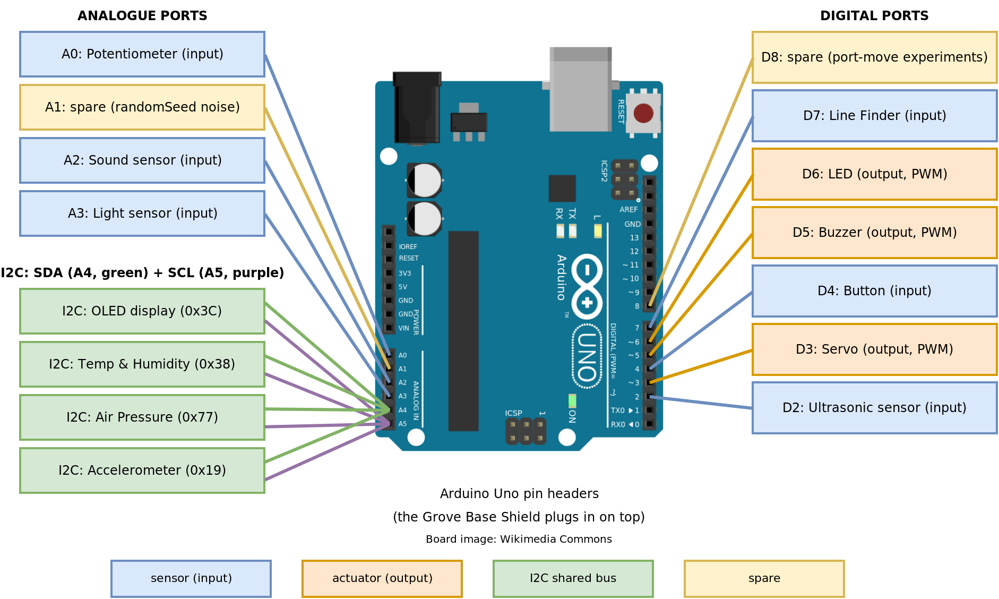

# LightTouch Adaptive Controller Project

This is the folder structure and starter files for students completing the TempeHS Arduino Bootcamp.

The bootcamp uses the **official [Arduino Sensor Kit](https://sensorkit.arduino.cc/)**: a Grove base shield and prewired modules that connect with Grove cables (no breadboard wiring needed for the kit modules). Your kit also includes a **Grove Line Finder** and a **Grove 3-pin Ultrasonic sensor**. The motor activities use real wiring with external power.

## Overview of LightTouch
The  proposed device is a light touch adaptive gaming controller that senses gentle hand movements and low-force inputs, then converts them into precise Xbox controller actions. It will use large, soft touch pads as the input surfaces, paired with a microcontroller that interprets each movement and sends the correct command to the console. This device is designed for Anna, a teenage gamer whose upper limb strength is declining due to Duchenne muscular dystrophy. She struggles with standard Xbox controllers due to the buttons being too small and sensitive, and her hands fatigue quickly. Anna’s medical notes show that her upper limb strength will continue to decline, and she already finds it difficult to press small buttons accurately. This means traditional controllers are no longer accessible to her. This adaptive controller will allow Anna to continue gaming comfortably and independently, restoring an activity that is socially and emotionally important to her. By reducing the physical effort required and preventing mis presses, the device will let her focus on gameplay rather than her limitations. It will support her long-term needs, maintain her confidence, and ensure she can keep enjoying the games she loves.

## Profile of patient
### Anna
Hi, my name is Anna, I love to game, I love all sorts of games, but mostly, I love platformers and infinite runners. I was born with muscular dystrophy, and my doctors tell me it is getting worse. About four years ago, I was finding keyboards too difficult, but I found freedom when someone showed me how to connect an Xbox controller to my PC. Sadly, in the last month, I stopped being able to use my Xbox controller, which really sucks, just because the buttons and joystick are too sensitive and too small.

What I really need is a game controller just for me!

If you would like to know more about what I need, please email me Anna c/o benjamin.jones21@det.nsw.edu.au

### Summary of Medical notes:
- DMD gene alteration
- Congenital Duchenne muscular dystrophy
- First identified at four months
- Upper limb mobility and strength declining

Referring Specialist: Ben Jones - benjamin.jones21@det.nsw.edu.au

## High-level pictorial

## Components included
- Soft‑touch capacitive/force‑sensing pad
- Microcontroller (Arduino or Teensy with USB HID support)
- USB cable
- Prototype casing (3D printed or acrylic)
- LED indicator or vibration motor (feedback module)
- Wiring and connectors

## Getting started

1. Click **Use this template** then **Create a new repository**
2. Name it using the class convention: `2027CT_Arduino_Bootcamp_FirstName.Initial` (e.g. `2027CT_Arduino_Bootcamp_Ben.J`)
3. Open your repository in a **GitHub Codespace** (the **Arduino to Codespaces Bridge** extension installs automatically)
4. Plug in your Arduino Uno, click the bridge icon in the left navigation bar, run the server, then open the bridge
5. Upload a sketch through the bridge and you are ready to code

Full setup instructions are on the learning platform: **Arduino Bootcamp, Page 1: What is Mechatronics?**

## The working rhythm

**Write** the code in your Codespace, **Upload** it to the Arduino, **Test** it with the sensor kit, then **Commit and Push** every working solution with a clear message and a photo of your build.

## Folder guide

| Folder                      | Lesson                                        | Hardware                                      |
| --------------------------- | --------------------------------------------- | --------------------------------------------- |
| `01.serialMonitor`          | Serial Monitor & Program Structure            | none                                          |
| `02.storingData`            | Variables & Data Types                        | none                                          |
| `03.buttonsAndDecisions`    | Digital I/O + selection (if/else/switch)      | Button D4, LED D6, Line Finder D7             |
| `04.analogueInOut`          | Analogue input + math + PWM output            | Pot A0, Sound A2, Light A3, LED D6, Buzzer D5 |
| `05.loopsAndTime`           | Loops + delay vs millis + random              | Button D4, Buzzer D5, LED D6                  |
| `06.servoMotor`             | Positional servo with the Servo library       | Servo D3, Pot A0                              |
| `07.ultrasonicAndFunctions` | Ultrasonic library + structuring functions    | Ultrasonic D2, Buzzer D5, LED D6              |
| `08.motorFundamentals`      | Direct-wire a DC motor + motor control theory | DC motor, battery pack (real wiring)          |
| `09.I2C`                    | I2C bus, OLED display and sensors             | OLED + I2C sensors                            |
| `10.OOP`                    | Object-Oriented Programming                   | LED D6 + built-in LED                         |
| `11.myProjects`             | Capstone builds                               | your choice                                   |

Each sketch's header comment lists the learning intention, success criteria and Grove ports for that activity. Folders also contain **optional breadboard schematics** (`Bootcamp-*.png`) showing how the same circuits are wired by hand without Grove modules, for anyone who wants to look under the hood.

## Standard Grove ports

| Module                                             | Port    |
| -------------------------------------------------- | ------- |
| **DO NOT USE** (TX/RX serial to your computer)     | D0 / D1 |
| Ultrasonic (3-pin)                                 | D2      |
| Servo                                              | D3      |
| Button                                             | D4      |
| Buzzer                                             | D5      |
| LED                                                | D6      |
| Line Finder                                        | D7      |
| Spare (port-move experiments)                      | D8      |
| Potentiometer                                      | A0      |
| Spare (leave unconnected: `randomSeed` noise)      | A1      |
| Sound sensor                                       | A2      |
| Light sensor                                       | A3      |
| OLED, Temp & Humidity, Air Pressure, Accelerometer | I2C     |

## Libraries

Install these once via the bridge web interface **Libraries** tab:

| Library                | Needed from                                                        |
| ---------------------- | ------------------------------------------------------------------ |
| `Servo` (by Arduino)   | `06.servoMotor` onwards                                           |
| `Arduino_SensorKit`   | `09.I2C` (OLED + kit I2C sensors; installs U8g2 automatically)    |

The Ultrasonic library is bundled inside `07.ultrasonicAndFunctions` and needs no install.

## Links

1. [Arduino Sensor Kit documentation](https://sensorkit.arduino.cc/)
2. [Design Toolkit](https://tempehs.github.io/designToolKit/)
3. [TempeHS Arduino Boilerplate](https://github.com/TempeHS/TempeHS_Ardunio_Boilerplate) including the school sensor, module, shield and electronic component catalogue
